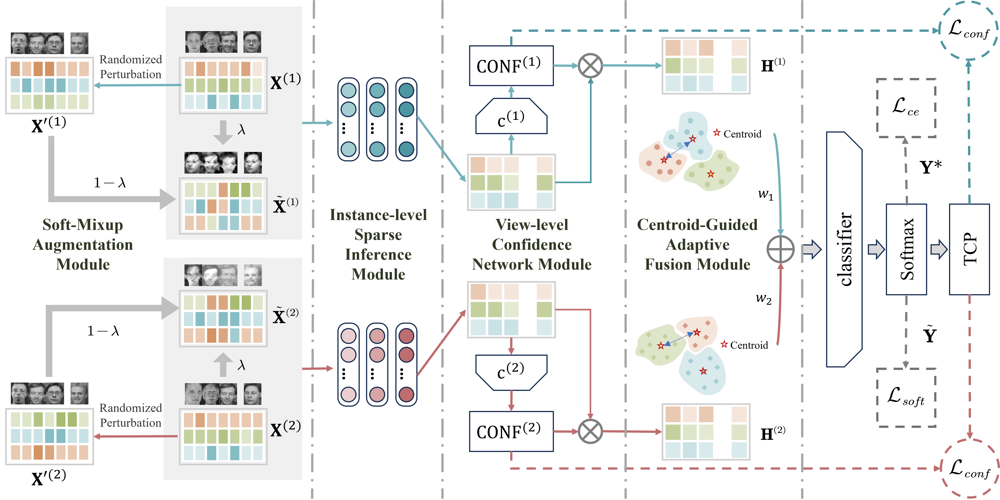

# Beyond the Known: Ambiguity-Aware Multi-view Learning

<h2 align="center"><a href="https://dl.acm.org/doi/10.1145/3664647.3681362">Beyond the Known: Ambiguity-Aware Multi-view Learning</a></h2>

<div align="center">

**Zihan Fang<sup>1</sup>, Shide Du<sup>1</sup>, Yuhong Chen<sup>1</sup>, Shiping Wang<sup>1</sup>**

<sup>1</sup>Fuzhou University, Fuzhou, China<br>
</div>

## Abstract

Open multi-view learning must recognize known categories while remaining reliable when test samples come from unknown categories. We propose an Ambiguity-Aware Multi-view Learning framework (AAML) that broadens the learnable space with soft-mixed samples and uncertainty-aware labels. A one-step instance-level sparse inference module suppresses redundant information and maps heterogeneous views into a common space. A view-level confidence network gates view-specific representations, while a centroid-guided adaptive fusion module dynamically weights views according to inter-class dispersion. Together, these modules improve open-set recognition while preserving closed-set classification performance.

## Model Architecture

<div align="center">
  
</div>

### Datasets Preparation

The experiments use six multi-view benchmarks:

| Dataset | # Samples | Feature dimensions by view | # Classes | Type |
|---|---:|---|---:|---|
| ESP-Game | 11,032 | 100 / 100 | 7 | Multi-view image/game data |
| Flower17 | 1,360 | 1,360 / 1,360 / 1,360 / 1,360 / 1,360 / 1,360 / 1,360 | 17 | Image data |
| MNIST | 2,000 | 1,930 / 9 / 30 | 10 | Digit images |
| Reuters | 1,500 | 21,531 / 24,892 / 34,251 / 15,506 / 11,547 | 6 | Text documents |
| ORL | 400 | 512 / 59 / 864 / 254 | 40 | Face images |
| Youtube | 2,000 | 2,000 / 1,024 / 64 / 512 / 64 / 647 | 10 | Video features |

Place the corresponding `.mat` files in the data directory expected by the training script:

```text
data/
├── esp_game.mat
├── flower17.mat
├── MNIST.mat
├── ORL.mat
├── smallReuters.mat
└── Youtube.mat
```

### Usage

```bash
python test.py
```

### Evaluation

Open-set performance is reported with the Open-Set Classification Rate (OSCR), using CCR at FPR values of `0.5%`, `1.0%`, `5.0%`, and `10.0%`.

## Citation

If you find this work useful, please cite:

```bibtex
@inproceedings{fang2024beyond,
  title={Beyond the Known: Ambiguity-Aware Multi-view Learning},
  author={Fang, Zihan and Du, Shide and Chen, Yuhong and Wang, Shiping},
  booktitle={Proceedings of the 32nd ACM International Conference on Multimedia},
  pages={8518--8526},
  year={2024},
  doi={10.1145/3664647.3681362}
}
```
